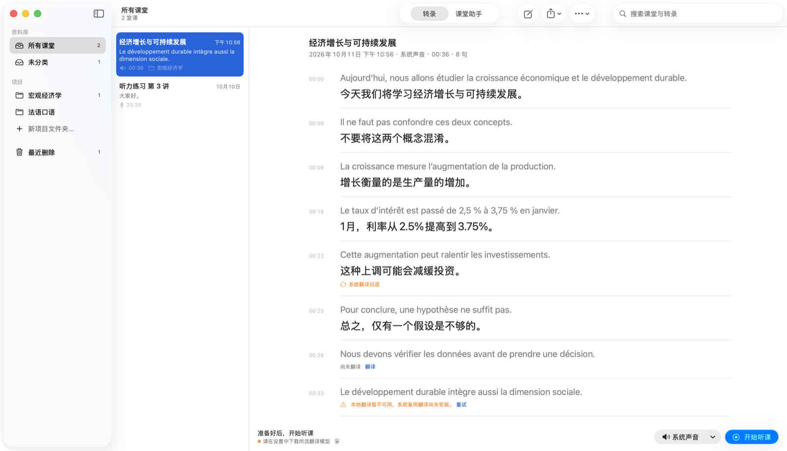
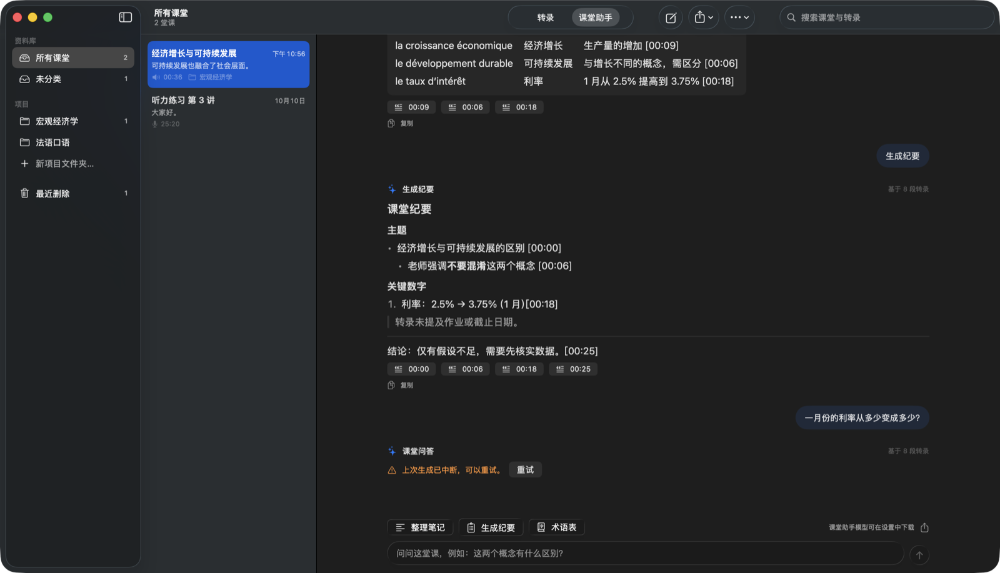
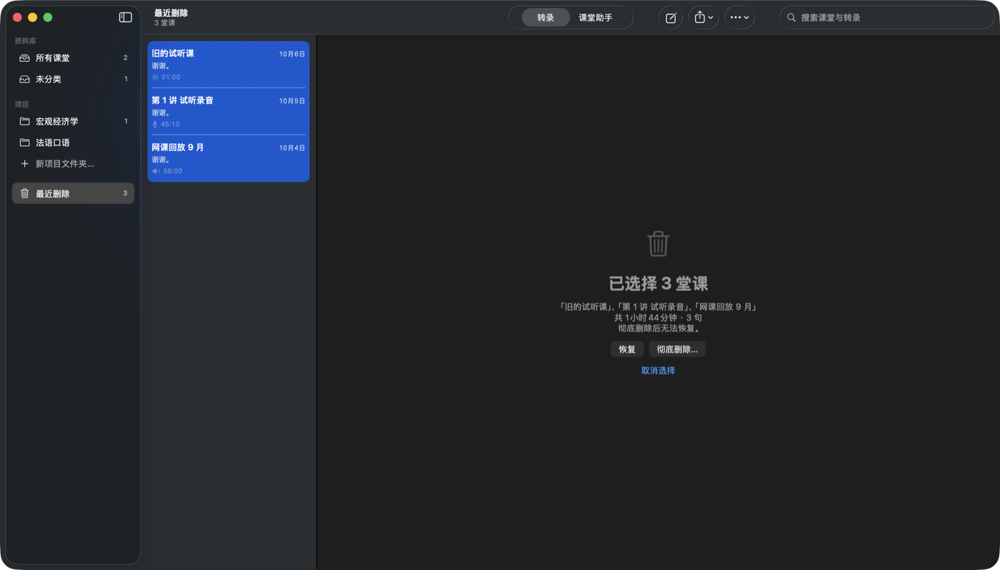

# ClairClass

**Live French → Simplified Chinese lecture captions for macOS, fully on-device.**

[简体中文](README.zh-CN.md)

ClairClass (法语听课助手) listens to a lecture — from the microphone in a classroom or from your Mac's system audio for online courses and videos — transcribes the French with Apple's on-device speech recogniser and translates every sentence into Simplified Chinese with a local TranslateGemma model. After class, a local Gemma model turns the transcript into study notes, minutes, a term glossary or answers to your questions, with timestamps that jump back to the source sentence. Nothing is sent to a cloud service.



## Features

- **Bilingual live captions** – French and Chinese side by side, from the microphone, system audio, or an imported audio file (drag a file onto the window).
- **Whole-sentence translation** – when the speaker pauses mid-sentence the halves are joined before translating; fillers such as *euh* and stutters are left out of the translation input.
- **Honest output** – lines that fell back to the system translator are labelled and re-translated with Gemma once the class is paused or over; words the recogniser was unsure of are underlined so you know what to check.
- **Class assistant** – organised notes, minutes, glossaries (rendered as tables) and Q&A grounded in the transcript, with timestamp citations; export as Markdown.
- **Library** – projects, multi-selection with batch move / delete, Recently Deleted with restore or permanent deletion (always confirmed).
- **Native macOS 26 design** – sidebar / list / detail layout, Liquid Glass capture controls, ⌘K command palette, full menu bar and keyboard shortcuts, light and dark appearance.
- **Local models, managed in Settings** – download TranslateGemma 4B/12B and Gemma 3 4B/12B from the official Ollama registry with SHA-256 verification; the bundled model service is restarted automatically if it stops.

| Class assistant (dark) | Batch selection in Recently Deleted |
|---|---|
|  |  |

## Requirements

- Apple silicon Mac with **macOS 26 (Tahoe)** or later. 16 GB of memory or more is recommended for the 4B models.
- To build: **Xcode 26** or later (command-line tools are enough).
- About 7 GB of free disk space for the two 4B models.

## Build and run

```sh
git clone https://github.com/steinyanaa/ClairClass.git
cd ClairClass
scripts/fetch-runtime.sh      # official Ollama runtime (~170 MB), signature-checked
scripts/build.sh              # → dist/ClairClass.app
open dist/ClairClass.app
```

On first launch open **Settings → 本地模型 (Local models)** and download a translation model and an assistant model. macOS asks for microphone or screen & system audio recording permission the first time you use each source.

`scripts/package.sh` creates a DMG in `dist/`. Builds are signed ad hoc and are not notarised; to distribute them to other Macs, sign with your own Developer ID.

## Tests

```sh
scripts/test.sh                          # unit tests (no models needed)
scripts/make-sample-audio.sh             # synthesise the public French test lecture
scripts/test.sh --pipeline .build/french-sample.aiff --realtime   # end to end, needs the app's model service running
scripts/test.sh --study                  # class assistant, needs the assistant model
```

Measured results and known limits are in [docs/TESTING.md](docs/TESTING.md).

## Privacy

- Speech recognition, translation and the assistant run on your Mac. The model service listens on `127.0.0.1` only and Ollama's cloud features are disabled.
- Live audio and screen content are never stored. Transcripts, translations and assistant answers are saved as JSON in `~/Library/Application Support/ClairClass/`.
- Network access is used only to download Apple language assets and the models you choose.

## Project layout

| Path | Contents |
|---|---|
| `Sources/` | The app (SwiftUI). `Session.swift` capture and translation pipeline, `Audio.swift` microphone / system audio / file capture and recognition, `Translation.swift` model service and downloads, `Study.swift` assistant, `Library.swift` storage, `DesignSystem.swift` spacing, type and motion tokens, plus one file per screen. |
| `Tests/` | Test driver (unit tests and end-to-end modes) and the public test lecture text. |
| `Tools/` | Icon generator and a helper that repeats audio for long tests. |
| `Resources/` | Info.plist, entitlements and the in-app user guide. |
| `scripts/` | Build, test, packaging and runtime download scripts. |

## Contributing

Issues and pull requests are welcome — see [CONTRIBUTING.md](CONTRIBUTING.md). Report security problems privately as described in [SECURITY.md](SECURITY.md).

## License

ClairClass is released under the [MIT License](LICENSE). The bundled Ollama runtime and the downloadable Gemma models have their own licenses; see [THIRD_PARTY_NOTICES.md](THIRD_PARTY_NOTICES.md). Model output can be wrong — always check translations and notes against the transcript.
